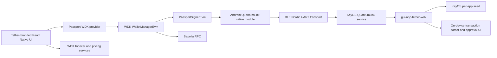

# Passport Prime + Tether WDK POC Implementation Plan

## 1. Objective

Build an Android proof of concept that presents the official Tether WDK wallet
experience while using Passport Prime as the only key custodian and signer.

The phone will:

- run the Tether-branded wallet UI;
- use WDK to build, quote, submit, and track Ethereum transactions;
- connect to Passport Prime over QuantumLink;
- hold no wallet seed or EVM private key;
- send every signing request to Passport for independent parsing, review, and
  approval.

Passport Prime will:

- derive the wallet deterministically from its KeyOS per-app seed;
- expose public account information over QuantumLink;
- independently parse and validate each transaction;
- show the destination, asset, amount, network, and maximum fee;
- sign only after explicit approval on the Passport screen.

### Research baseline

This plan was checked against:

- official Tether WDK build-with-AI and React Native documentation;
- `tetherto/wdk-starter-react-native` at
  `14f8963427091997f0fb397df2a2cab5d1f01d05`;
- current published WDK prerelease packages as of 23 July 2026;
- the private `Foundation-Devices/PubkyRing` implementation at
  `bb2dbb03ae8dd6dc8d146637c1d049c20fc5ef1e`;
- the local Envoy QuantumLink implementation at
  `22add007d379ef20479135c60be8d3870df68179`;
- the local KeyOS development base at
  `87a5b7236bc8b739d892c6be0de7718803352fcf`.

The local KeyOS checkout contains unrelated user changes, so implementation
must use a separate clean worktree at the pinned base.

## 2. Agreed POC Scope

### Included

- Android only.
- Official `tetherto/wdk-starter-react-native` as the mobile starting point.
- Current Tether branding and the official React Native UI kit.
- Ethereum Sepolia.
- The Sepolia USD₮ asset used by the WDK documentation.
- A single Passport-backed account at `m/44'/60'/0'/0/0`.
- QuantumLink pairing, reconnect, status, request correlation, and unpairing.
- Wallet dashboard, balance, transaction history, receive, send, activity, and
  settings flows.
- WDK fee estimation, transaction construction, broadcast, and receipt/status
  handling.
- Native ETH and allowlisted USD₮ transfer review on Passport.
- A physical Android release APK.
- A physical Passport Prime KeyOS application and reproducible device build
  output.

### Explicitly deferred

- iOS.
- Mainnet or real-fund use.
- Bitcoin, Spark, TON, Tron, Solana, RGB, swaps, bridges, lending, and fiat
  on/off-ramp execution.
- ERC-4337 account abstraction and gas sponsorship.
- Arbitrary smart-contract calls.
- Blind EIP-712 signing.
- Production signing, security audit, and app-store release.

The UI can retain the broader Tether wallet structure, but unsupported networks
and actions must be hidden rather than presented as functional.

## 3. Definition of Done

The POC is complete when all of the following pass on physical hardware:

1. A clean Android install pairs with a Passport Prime over QuantumLink.
2. The phone obtains the EVM address from Passport without receiving a seed or
   private key.
3. The address matches the expected KeyOS per-app-seed derivation.
4. The app displays live Sepolia ETH and USD₮ balances.
5. The app displays a receive QR for the Passport-backed address.
6. The app builds and quotes a USD₮ transfer through WDK.
7. Passport independently decodes the transaction and displays:
   - Ethereum Sepolia;
   - USD₮;
   - recipient;
   - token amount;
   - maximum network fee.
8. Rejecting on Passport returns a clean cancellation state to the phone and
   broadcasts nothing.
9. Approving on Passport returns a valid signed EIP-1559 transaction.
10. The phone broadcasts the signed transaction and shows its pending and
    confirmed state.
11. No wallet seed or EVM private key is present in phone storage, JavaScript
    state, logs, crash output, or the QuantumLink payload.
12. Release APK, KeyOS app/device artifact, source, test vectors, and a demo
    runbook are reproducible from the repository.

## 4. System Architecture



### Trust boundary

The phone is an untrusted transaction coordinator. It may request signatures,
but it cannot authorize them or provide trusted display metadata. Passport
derives the signing key, reconstructs the signing hash, decodes the transaction,
and renders the authoritative review.

## 5. Mobile Application Design

### 5.1 Base and dependency policy

Start from the latest commit on the official React Native starter and preserve
its Expo/React Native architecture and Tether visual system.

Pin exact tested versions in the lockfile. The initial compatibility target is:

- Expo 54;
- React Native 0.81.x;
- `@tetherto/wdk-wallet` 1.0.0-beta.15;
- `@tetherto/wdk-wallet-evm` 1.0.0-beta.16;
- the latest compatible WDK Indexer, pricing, and Tether UI kit packages.

The starter and WDK packages are prerelease software. Version upgrades after the
known-good lockfile is established require the full integration test suite.

### 5.2 WDK integration

Use the current external-signer support in `WalletManagerEvm`.

Implement `PassportSignerEvm`, matching the WDK EVM signer contract:

- `isDerivable`;
- `derive(relativePath)`;
- `getAddress()`;
- `signTransaction(unsignedTransaction)`;
- `dispose()`.

The following methods must fail closed in the first POC unless a dedicated
Passport review flow is implemented:

- `sign(message)`;
- `signTypedData(...)`;
- `signAuthorization(...)`.

Construct the WDK manager with the Passport signer:

```text
PassportSignerEvm
  -> WalletManagerEvm
  -> WalletAccountEvm
  -> WDK quote / transfer / broadcast APIs
```

No dummy wallet seed will be supplied to WDK.

### 5.3 Runtime choice and compatibility spike

Preferred implementation:

- run `@tetherto/wdk-wallet-evm` in the React Native Hermes runtime;
- allow `PassportSignerEvm` to call the Android native QuantumLink module
  directly;
- expose an app-level `PassportWdkProvider` with hooks shaped for the existing
  starter screens.

This avoids placing a Bluetooth-dependent signer inside WDK's isolated Bare
worklet, where the React Native native module is not directly available.

The first implementation gate is a minimal Android spike that proves:

1. `WalletManagerEvm` initializes under Hermes;
2. a fake asynchronous external signer can derive an address;
3. WDK can quote and serialize a Sepolia transaction;
4. WDK can accept a remotely returned signature and broadcast the transaction.

Fallback if direct Hermes execution is incompatible:

- extend the Bare worklet HRPC contract with bidirectional signer requests;
- handle those requests on the React Native host;
- forward them through QuantumLink;
- return the Passport result to the worklet.

The fallback preserves the same `PassportSignerEvm` interface and protocol
vectors, but it is more invasive and should only be used if the preferred spike
fails.

### 5.4 UX changes

Replace seed-centric onboarding with:

1. Welcome to Tether WDK with Passport Prime.
2. Explanation that Passport holds the wallet keys.
3. Bluetooth and camera permission setup.
4. Scan Passport's static QuantumLink pairing QR.
5. Establish BLE and scan the dynamic XID UR.
6. Complete QuantumLink pairing.
7. Fetch and verify the Passport-backed Ethereum address.
8. Enter the wallet dashboard.

Remove or disable:

- create seed;
- import seed;
- reveal seed;
- confirm recovery phrase;
- phone-side wallet backup.

Add:

- persistent Sepolia testnet banner;
- Passport connection indicator;
- reconnect action;
- unpair action;
- derivation path and address details;
- clear waiting, reviewing, rejected, signing, broadcasting, and confirmed
  states;
- a prominent warning that the build is a testnet POC.

### 5.5 Branding

Retain official Tether:

- splash treatment;
- orange, black, white, and neutral palette;
- typography;
- token and network iconography;
- bottom navigation and card patterns;
- wallet, activity, send, receive, and settings layouts.

Passport integration should be presented as a feature inside the Tether
experience, with restrained Foundation attribution such as "Secured by Passport
Prime." It should not become a Foundation-themed reskin.

## 6. QuantumLink Mobile Bridge

### 6.1 Starting point

Extract and generalize the working PubkyRing Android implementation:

- React Native module boundary;
- Kotlin BLE central;
- Nordic UART Service discovery;
- MTU 247 negotiation;
- ordered write queue;
- reconnect and lifecycle handling;
- Rust `foundation-api` QuantumLink core;
- BTP chunking/dechunking;
- GSTP sealing and replay protection;
- UniFFI-generated Kotlin bindings.

Pubky-specific request builders and response handlers must not be copied into
the Tether integration.

### 6.2 Proposed module surface

```text
QuantumLink.isAvailable()
QuantumLink.scan()
QuantumLink.connect(deviceId)
QuantumLink.pair(primeXid, phoneName)
QuantumLink.reconnect()
QuantumLink.getStatus()
QuantumLink.getEvmAccount(path)
QuantumLink.signEvmTransaction(request)
QuantumLink.cancel(requestId)
QuantumLink.unpair()
```

Events:

```text
connectionChanged
pairingChanged
requestProgress
requestRejected
requestCompleted
unpairedByPassport
```

### 6.3 Android security and lifecycle

- Store the phone QuantumLink identity encrypted with an Android Keystore-backed
  key.
- Store only public Passport pairing metadata outside encrypted storage.
- Never log identities, sealed payloads, unsigned transactions, signed
  transactions, or addresses in release builds.
- Handle Android 12+ Bluetooth permissions and pre-Android-12 location
  requirements.
- Recover from app backgrounding, BLE disconnects, stale GATT sessions, and
  Passport-side unpairing.
- Limit the release artifact to `arm64-v8a` unless an additional ABI is needed
  for automated testing.
- Add a reproducible Gradle task for Rust, cargo-ndk, UniFFI binding generation,
  and `.so` packaging.

## 7. QuantumLink Protocol Extension

Add versioned WDK message types to a Foundation API fork pinned to the KeyOS
base:

```text
WdkEvmAccountRequest
WdkEvmAccountResponse
WdkEvmSignTransactionRequest
WdkEvmSignTransactionResponse
WdkRequestRejected
WdkRequestCancelled
```

Every request includes:

- protocol version;
- 128-bit request ID;
- derivation path;
- creation timestamp and expiry;
- chain ID;
- canonical unsigned transaction data.

Every response includes:

- matching request ID;
- result or typed error;
- signed transaction only after approval.

### Protocol rules

- Use the existing QuantumLink GSTP envelope and BTP chunking.
- Reject expired, duplicated, replayed, or mismatched request IDs.
- Permit only Ethereum Sepolia chain ID `11155111`.
- Permit only the approved derivation path family.
- Set explicit maximum message sizes before allocation.
- Cancel pending UI state when the phone disconnects or cancels.
- Do not trust phone-supplied token names, amounts, fee labels, or fiat values.

## 8. Passport Prime KeyOS Application

### 8.1 Application

Create `gui-app-tether-wdk` as a normal KeyOS application with:

- app-seed permission;
- QuantumLink request/response permission;
- a Tether-branded Slint UI;
- no private-key persistence;
- no seed export function.

Use a clean KeyOS worktree pinned to a Foundation API 5.7.0-compatible commit.
Do not build this integration directly inside the dirty local
`KeyOS-dev2` worktree.

### 8.2 Key derivation

Use the KeyOS per-app seed as the deterministic root and implement standard EVM
BIP-44 derivation:

```text
m/44'/60'/0'/0/0
```

The app stores only non-secret preferences. It re-derives the key when required
and zeroizes secret material after use.

Account responses include:

- checksummed Ethereum address;
- compressed or uncompressed public key as required by the protocol;
- derivation path;
- protocol version.

### 8.3 EVM implementation

Reuse KeyOS-compatible primitives already present in the workspace:

- secp256k1 with recoverable ECDSA signatures;
- BIP32 derivation;
- Keccak-256 via the existing `sha3` dependency.

Add or vendor a small no-std-compatible EVM transaction codec for:

- EIP-1559 typed transaction decoding;
- signing-payload reconstruction;
- RLP encoding;
- recovery ID handling;
- signed transaction serialization;
- ERC-20 `transfer(address,uint256)` decoding.

Do not accept a precomputed hash from the phone as the signing authority.
Passport must reconstruct the signing hash from the canonical transaction.

### 8.4 Transaction policy

Allow:

- native Sepolia ETH transfer with empty calldata;
- ERC-20 transfer call with selector `a9059cbb`;
- the single allowlisted Sepolia USD₮ contract;
- the configured derivation path;
- chain ID 11155111.

Reject:

- contract creation;
- unknown calldata;
- unknown token contracts;
- approvals;
- swaps;
- chain ID mismatch;
- malformed or non-canonical RLP;
- fees or values outside defined bounds;
- transactions whose `from` address does not match the derived Passport
  account.

### 8.5 Review UI

Review sequence:

1. Request received.
2. Network and asset.
3. Recipient.
4. Amount.
5. Maximum network fee.
6. Full address details on demand.
7. Slide to approve or reject.
8. Signed result or error state.

All displayed security-critical fields come from the Passport parser.

## 9. KeyOS and Foundation API Integration

Following the proven PubkyRing pattern:

1. Add WDK message structures and enum tags to the Foundation API fork.
2. Extend `api/quantum-link` manifests with the new request and response IDs.
3. Extend the KeyOS QuantumLink service to route WDK requests to
   `gui-app-tether-wdk`.
4. Route approved or rejected responses back to the paired phone.
5. Register the app in the KeyOS workspace, build lists, launcher, permissions,
   localization, and icon resources.
6. Add a simulator-only transport or fixture harness so transaction parsing and
   approval can be exercised without BLE.

Message tags must be checked against the current Foundation API enum before
assignment to avoid collisions.

## 10. Delivery Phases and Verification Gates

### Phase 0: Reproducible baselines

- Pin the WDK starter commit.
- Pin WDK package versions.
- Pin KeyOS and Foundation API commits.
- Add repository instructions and build prerequisites.
- Install or verify Android NDK 27 and `cargo-ndk`.

Gate:

- untouched starter builds a release APK;
- clean KeyOS base passes its normal targeted check;
- no user POC worktree is modified.

### Phase 1: WDK external-signer spike

- Implement a fake `PassportSignerEvm`.
- Derive a known account.
- Quote and construct a Sepolia USD₮ transfer.
- Return a deterministic test signature.
- Broadcast against a local or controlled RPC test.

Gate:

- WDK transaction bytes match ethers/reference vectors;
- no phone-side seed is required;
- preferred Hermes architecture is confirmed or the HRPC fallback is selected.

### Phase 2: QuantumLink bridge extraction

- Generalize the PubkyRing Rust and Kotlin bridge.
- Add secure identity persistence.
- Add a mock request/response message.
- Add BLE connection state and reconnect handling.

Gate:

- Android arm64 native library loads in a release build;
- physical phone pairs with Prime;
- sealed mock round-trip succeeds repeatedly after reconnect.

### Phase 3: Protocol and KeyOS signer core

- Add WDK Foundation API messages.
- Implement app-seed derivation and address generation.
- Implement EIP-1559 and ERC-20 transaction parsing.
- Implement signature and signed-transaction serialization.
- Add negative-policy tests.

Gate:

- cross-language test vectors pass in TypeScript and Rust;
- signature recovers the Passport-derived address;
- malformed and disallowed transactions are rejected before the approval UI.

### Phase 4: Passport UI and QL routing

- Build Tether-branded KeyOS screens.
- Route account and signing requests.
- Implement approve, reject, cancel, timeout, and disconnect states.
- Add launcher and manifest integration.

Gate:

- hosted simulator completes address and sign fixtures;
- both KeyOS target checks pass;
- secrets are absent from logs.

### Phase 5: Tether mobile integration

- Replace seed onboarding with Passport pairing.
- Add `PassportWdkProvider`.
- Wire dashboard, balance, receive, send, activity, and settings.
- Add testnet and connection-state UX.
- Remove unsupported networks and flows.

Gate:

- mobile unit, type, lint, and integration tests pass;
- fake-signer end-to-end flow covers approve and reject;
- release APK builds with bundled JavaScript and native library.

### Phase 6: Physical end-to-end validation

- Install the Android release APK.
- Install or flash the KeyOS app/device build.
- Pair from a clean state.
- Fund the derived address with Sepolia ETH and test USD₮.
- Run receive and send flows.
- Test rejection, cancellation, disconnect, reconnect, replay, wrong chain,
  unknown contract, and fee-boundary cases.

Gate:

- definition of done passes on physical devices;
- successful transaction is independently verified on Sepolia;
- no high-severity security or correctness issue remains open.

### Phase 7: Handoff

- Produce signed-off source snapshot.
- Produce release APK and checksums.
- Produce KeyOS app/device artifact and checksums.
- Produce build, flash/install, pairing, funding, and demo instructions.
- Produce architecture, protocol, threat-model, and known-limitations docs.
- Capture polished Android and Passport screenshots plus a short demo recording.

## 11. Test Matrix

### Cryptographic and protocol tests

- Key derivation matches known BIP32 vectors.
- Ethereum address matches the reference WDK/ethers implementation.
- Legacy and EIP-1559 parsing behavior is explicit.
- EIP-1559 signing hash matches reference vectors.
- Signed transaction recovers the expected address.
- ERC-20 calldata decoder handles leading zeros and maximum values.
- Replay, expiry, duplicate ID, wrong sender, and corrupt envelope rejection.
- Chunk loss, duplication, reordering, and oversized input handling.

### Policy tests

- Correct Sepolia USD₮ transfer accepted.
- Native ETH transfer accepted.
- Wrong chain rejected.
- Unknown token rejected.
- Approval selector rejected.
- Arbitrary contract call rejected.
- Contract creation rejected.
- Excessive fee rejected.
- Invalid derivation path rejected.
- Phone display metadata cannot change Passport review fields.

### Mobile tests

- Fresh onboarding and pairing.
- Permission denied and later granted.
- Invalid static QR and invalid XID UR.
- BLE connection timeout.
- App background/foreground.
- Reconnect after Passport sleeps.
- Phone restart and Passport restart.
- User rejects on Passport.
- User approves on Passport.
- Broadcast fails after signing and can be retried safely.
- Indexer unavailable fallback.
- Empty, loading, pending, confirmed, and failed states.

### Hardware tests

- Clean Android install.
- Clean Passport pairing state.
- Repeated pair/unpair cycles.
- At least ten consecutive sign round-trips.
- Mid-transfer BLE disconnect.
- Mid-review disconnect.
- Low phone battery/background restrictions.
- Passport locked, asleep, out of range, and already connected elsewhere.

## 12. Security Invariants

- The wallet seed and EVM private key never leave Passport.
- The phone never supplies the hash that Passport blindly signs.
- Passport parses the canonical transaction and derives every review field.
- Only the expected chain, token, call type, and derivation path are allowed.
- Every spend requires an explicit Passport approval gesture.
- A rejection, timeout, disconnect, or parsing ambiguity fails closed.
- Release logs contain no sensitive protocol or transaction payloads.
- Testnet status is always visible.
- POC artifacts are never represented as audited or mainnet safe.

## 13. Repository Layout

```text
passport-tether-wdk/
  mobile/                       Tether WDK React Native fork
    src/passport/               WDK signer/provider and pairing UX
    modules/quantumlink/        Rust QuantumLink mobile core
    android/...                 Kotlin React Native module and JNI packaging
  prime-app/                    gui-app-tether-wdk Rust/Slint source
  foundation-api/               pinned fork or reproducible patch set
  keyos-patches/                QL routing, manifests, launcher, workspace
  protocol-vectors/             shared address and transaction fixtures
  scripts/                      bootstrap, native build, install, test, demo
  docs/
    architecture.md
    protocol.md
    security.md
    hardware-runbook.md
    known-limitations.md
  IMPLEMENTATION_PLAN.md
```

## 14. Principal Risks and Mitigations

| Risk | Mitigation |
| --- | --- |
| WDK starter and packages are prerelease | Pin exact versions and lockfile; require full regression tests for upgrades |
| EVM external signer is newly released | Make it the first spike and back it with cross-language vectors |
| WDK package fails under Hermes | Use the defined bidirectional HRPC fallback |
| Pubky bridge is app-specific | Extract transport and session layers, then replace all Pubky message code |
| QuantumLink message tag collision | Audit the pinned Foundation API enum before assigning tags |
| Phone lies about transaction details | Parse canonical transaction and enforce token/network policy on Passport |
| KeyOS target dependency incompatibility | Use existing secp256k1 and sha3 primitives plus a small no-std EVM codec |
| BLE lifecycle instability | Reuse proven write queue/reconnect logic and add physical stress tests |
| Local KeyOS tree contains unrelated changes | Use a clean pinned worktree and preserve the dirty tree |
| Android NDK/cargo-ndk is not installed | Add a versioned bootstrap check before native work |
| No Android device is currently attached | Treat physical validation as a required gate before completion |

## 15. Final Artifacts

- Android Tether mobile app source.
- Android release APK.
- Passport Prime KeyOS app source.
- Flashable/testable Passport artifact.
- Foundation API QuantumLink extension.
- Shared protocol and cryptographic vectors.
- Automated test suite.
- Hardware build and demo runbook.
- Architecture and security documentation.
- Known limitations statement.
- Screenshots and short end-to-end demonstration recording.
