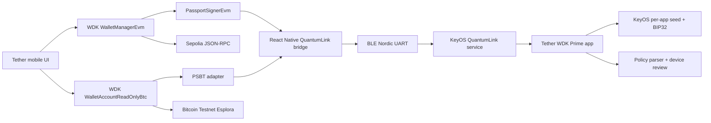

# Architecture

## Transaction path



The mobile app is the networked coordinator. It fetches balances/history,
asks WDK to quote/create EVM transactions or select Bitcoin UTXOs and fees,
transports canonical fields or a PSBT to Passport, verifies the returned signed
transaction, and broadcasts it.

Passport is the signing authority. It derives both keys and addresses, ignores
phone display labels, reconstructs the EIP-1559 signing payload or parses the
PSBT, and presents review fields calculated from the actual transaction.

## Mobile layers

`PassportProvider` owns pairing state plus EVM and BTC wallet sessions. The EVM
service constructs WDK's `WalletManagerEvm` with a `PassportSignerEvm`. The BTC
service uses WDK's read-only account for balance, fee, and coin selection,
then creates a BIP-174 PSBT. Neither session creates or imports a phone seed.

The Kotlin layer handles Android permissions, exact-device BLE discovery,
connection lifecycle, serialized NUS writes, encrypted identity persistence,
and React Native promises/events. The Rust layer owns XID identities, pinned
peer authentication, pairing/GSTP, replay protection, BTP framing, CBOR
protocol messages, and request correlation.

## Prime layers

The KeyOS QuantumLink server accepts WDK requests only from the currently
paired XID and routes them to `gui-app-tether-wdk`. The app derives the one
enabled EVM and Bitcoin accounts from its isolated app seed, validates policy,
and shows a localized Slint approval view. Approved responses return a complete
signed type-2 transaction or finalized Bitcoin transaction through the same
authenticated session.

## Key ownership

```text
Passport app seed
  ├── BIP32 m/44'/60'/0'/0/0
      ├── Ethereum address → phone (public)
      └── signing key → used transiently on Passport, then erased
  └── BIP84 m/84'/1'/0'/0/0
      ├── Bitcoin Testnet address/public key → phone
      └── signing key → used transiently on Passport, then erased

Phone
  ├── QuantumLink identity → Android Keystore-encrypted
  ├── paired Passport XID → public metadata
  └── EVM/BTC seed or private key → never exists
```

## Network scope

The application enables one account on each of two test networks: Ethereum
Sepolia (`11155111`) for native ETH and test USD₮ at
`0xd077a400968890eacc75cdc901f0356c943e4fdb`, plus native SegWit Bitcoin
Testnet. USA₮ and XAU₮ stay disabled until Tether publishes official public
test deployments and the corresponding signer policy is implemented.
