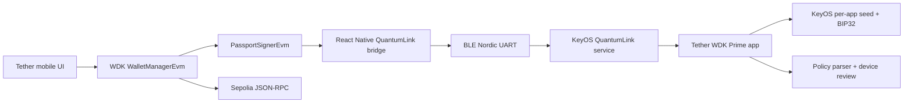

# Architecture

## Transaction path



The mobile app is the networked coordinator. It fetches balances/history,
asks WDK to quote and create transactions, transports canonical fields to
Passport, verifies the returned signed transaction, and broadcasts it.

Passport is the signing authority. It derives the key and address, ignores
phone display labels, reconstructs the EIP-1559 signing payload, and presents
review fields calculated from the actual transaction.

## Mobile layers

`PassportProvider` owns pairing state and one `PassportWalletService` session.
That service constructs WDK's `WalletManagerEvm` with a
`PassportSignerEvm`. The signer canonicalizes WDK transaction fields before
crossing the native boundary.

The Kotlin layer handles Android permissions, exact-device BLE discovery,
connection lifecycle, serialized NUS writes, encrypted identity persistence,
and React Native promises/events. The Rust layer owns XID identities, pinned
peer authentication, pairing/GSTP, replay protection, BTP framing, CBOR
protocol messages, and request correlation.

## Prime layers

The KeyOS QuantumLink server accepts WDK requests only from the currently
paired XID and routes them to `gui-app-tether-wdk`. The app derives the one
enabled EVM account from its isolated app seed, validates policy, and shows a
localized Slint approval view. Approved responses return the complete signed
type-2 transaction through the same authenticated session.

## Key ownership

```text
Passport app seed
  └── BIP32 m/44'/60'/0'/0/0
      ├── Ethereum address → phone (public)
      └── signing key → used transiently on Passport, then erased

Phone
  ├── QuantumLink identity → Android Keystore-encrypted
  ├── paired Passport XID → public metadata
  └── EVM seed/private key → never exists
```

## Network scope

The application is intentionally single-network and single-account:
Ethereum Sepolia (`11155111`), native ETH, and test USD₮ at
`0xd077a400968890eacc75cdc901f0356c943e4fdb`.

